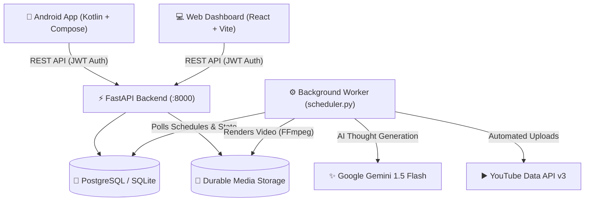

# ThoughtFlow AI

<p align="center">
  
</p>

<p align="center">
  <a href="https://github.com/SyedZiyan/thoughtflow-ai"></a>
  <a href="https://github.com/SyedZiyan/thoughtflow-ai"></a>
  <a href="https://github.com/SyedZiyan/thoughtflow-ai"></a>
  <a href="https://github.com/SyedZiyan/thoughtflow-ai"></a>
  <a href="https://github.com/SyedZiyan/thoughtflow-ai"></a>
</p>

---

## 🌟 What is ThoughtFlow AI?

**ThoughtFlow AI** is an autonomous content creation platform that generates daily motivational wisdom, turns thoughts into high-resolution quote cards and animated 9:16 vertical videos, and automatically publishes them to **YouTube Shorts**.

The project is structured into four integrated components:
1. **Native Android Mobile App**: Built with Kotlin and Jetpack Compose in a modern **Obsidian Dark Studio** theme.
2. **FastAPI Backend Server**: Secure REST API handling AI thought synthesis, video rendering, cryptographic OAuth lifecycle, and user data.
3. **Persistent Background Worker**: Autonomous scheduling daemon that executes multi-stage daily generation and publishing independently of incoming web traffic.
4. **Web Management Dashboard**: React / Vite interface for monitoring generation logs, queue states, and pipeline statistics.

---

## 📱 Mobile App Preview

Captured live from physical Android hardware:

<p align="center">
  
  &nbsp;&nbsp;
  
  &nbsp;&nbsp;
  
</p>

| 1. Dashboard | 2. Quote Generator | 3. Settings & Channel |
| :--- | :--- | :--- |
| Daily motivational thought, real-time generation stats, and quick actions. | Live procedural quote canvas with scenic backdrops and 1080p Gallery export. | Creator profile, linked YouTube channel (`@its-Zynk`), and locked backend URL protection. |

---

## ✨ Key Features

- **🎲 Procedural Style Randomizer (11,760 Combinations)**: Procedurally generates unique visual styles across 5 independent design dimensions implemented in [`PhotoExportUtil.kt`](apps/android/app/src/main/java/com/thoughtflow/ai/util/PhotoExportUtil.kt):
  - **16 Scenic Backdrops**: Alpine Trail, Sunrise Summit, Dramatic Peak, Sunset Ridge, Balcony Sunset, City Skyline Dusk, Misty Redwood, Starry Cosmos, Northern Cabin, Ocean Twilight, Golden Dunes, Rainy Evening Window, Fairy Lights Terrace, Cozy Lantern Window, Classical Library Desk, Metropolis Night Glow.
  - **5 Card Layout Templates**: Torn Sticker Note, Vintage Storybook, Retro Polaroid, Swiss Editorial, Frosted Glass.
  - **7 Accent Highlighter Palettes**: Sunburst Yellow, Matcha Mint, Warm Peach, Ice Cyan, Petal Rose, Amber Gold, Amethyst Purple.
  - **7 Typographic Header Ornaments**: Sunburst (`\ | /`), Floral Leaf (`— ❧ —`), Sparkle (`— ✦ —`), Diamond (`❖ ❖ ❖`), Traveler (`✈ - - -`), Stars (`★ ★ ★`), Glint (`✧ ✧ ✧`).
  - **3 Font Typography Families**: Classical Serif, Clean Modern Sans, Warm Cursive Script.
  $$\text{Total Procedural Variations} = 16 \times 5 \times 7 \times 7 \times 3 = 11,760\text{ unique visual styles}$$

- **🎬 Vertical Animated Video Shorts Engine**: Renders 1080×1920 vertical MP4 videos with dynamic kinetic typography, animated punch-in motion curves (*Cinematic Slow Zoom, Kinetic Vertical Pan, Subtle Breathing Pulse, Gentle Drift*), ambient audio synthesis, and EdgeTTS narration via local FFmpeg.

- **🚀 Scheduled YouTube Automation**: 
  - **Generation Stage (07:00 Daily)**: Generates and validates original thoughts using Google Gemini AI, renders vertical video, and saves assets to persistent storage.
  - **Publishing Stage (09:00 Daily)**: Uploads completed videos to your linked YouTube channel with optimized titles, descriptions, and hashtags.

- **📲 In-App Update Checking & Direct APK Download**: The Android app queries `/api/v1/app/version` on launch. When an update is released, users can 1-tap download the verified APK (`/api/v1/app/download`) for immediate in-place OS installation without requiring third-party app stores. A web-accessible download portal is also hosted at `/download`.

- **🔒 Hardened Security & Zero-Trust Architecture**:
  - Mandatory JWT authentication with strict `HTTP 401 Unauthorized` enforcement (no fallback to default accounts).
  - Single-use, cryptographically secure OAuth 2.0 state tokens (`secrets.token_urlsafe(32)`) with automatic expiration to prevent CSRF and replay attacks.
  - Strict resource ownership authorization on all jobs, videos, thoughts, and channel integrations.
  - Rate-limited login endpoints with constant-time verification to prevent brute-force and timing attacks.

---

## 🛠️ Architecture & Tech Stack



| Component | Technology | Role & Purpose |
| :--- | :--- | :--- |
| **Mobile App** | Kotlin, Jetpack Compose, Material 3, Coil | Native mobile client, quote cards, video studio, locked server URL |
| **Backend API** | Python 3.11+, FastAPI, SQLAlchemy, Pydantic | REST API, authentication, OAuth binding, health diagnostics |
| **Worker Daemon** | Python, APScheduler, Asyncio | Persistent scheduled daily generation (07:00) & publishing (09:00) |
| **Web Dashboard** | React, Vite, TailwindCSS | Web monitoring interface for schedules, queue states, and logs |
| **Video Engine** | FFmpeg, ffprobe, Pillow (PIL) | 1080×1920 9:16 vertical composition, audio mixing & subtitle rendering |
| **Database** | PostgreSQL 16 (Production) / SQLite (Dev) | Relational storage for users, thoughts, videos, jobs, and OAuth states |
| **Integrations** | YouTube Data API v3, Google Gemini AI | Cloud video publishing and structured philosophical thought generation |

---

## 🚀 Setup & Execution Guide

### 1. Environment & Credentials Configuration

Before running any component, set up your configuration file:

```bash
# Clone the repository
git clone https://github.com/SyedZiyan/thoughtflow-ai.git
cd thoughtflow-ai

# Create your local environment file
cp .env.example .env
```

Open `.env` and fill in the values for your setup:
- **Database**: Defaults to `sqlite:///./thoughtflow.db` for local development, or configure PostgreSQL for production.
- **AI Provider**: Set `AI_PROVIDER=gemini` and add `GEMINI_API_KEY` (get a free key from [Google AI Studio](https://aistudio.google.com/)). Leave as `mock` for 100% offline development.
- **YouTube OAuth 2.0 Credentials**:
  1. Open the [Google Cloud Console](https://console.cloud.google.com/).
  2. Enable the **YouTube Data API v3**.
  3. Create an **OAuth 2.0 Client ID** (Application type: *Web application*).
  4. Set **Authorized redirect URI** to:
     `http://localhost:8000/api/v1/youtube/callback`
  5. Copy `Client ID` and `Client Secret` into `GOOGLE_CLIENT_ID` and `GOOGLE_CLIENT_SECRET`.

---

### 2. Option A: Run Full Stack with Docker Compose (Recommended)

Docker Compose orchestrates all four services (PostgreSQL, Backend API, Worker Daemon, and Web Dashboard) with persistent volumes:

```bash
# Start all 4 containers in the background
docker compose up -d --build

# View container status
docker compose ps

# Follow logs from all services
docker compose logs -f
```

Accessible services:
- **Web Dashboard**: `http://localhost:3000`
- **Backend API Docs**: `http://localhost:8000/docs`
- **Health Check**: `http://localhost:8000/health`
- **APK Download Page**: `http://localhost:8000/download`

---

### 3. Option B: Run Components Individually (Local Development)

#### Component 1 — FastAPI Backend Server
```bash
cd backend
python -m venv .venv
source .venv/bin/activate  # Windows: .\.venv\Scripts\Activate.ps1
pip install -r requirements.txt

# Provision initial administrator account
python -m app.cli.init_admin --email admin@thoughtflow.ai --password "YourAdminPassword123!"

# Start the development server
uvicorn app.main:app --reload --host 0.0.0.0 --port 8000
```

#### Component 2 — Persistent Background Worker
In a separate terminal:
```bash
cd backend
source .venv/bin/activate  # Windows: .\.venv\Scripts\Activate.ps1
python ../worker/scheduler.py
```
The worker initializes the heartbeat (`storage/worker_heartbeat.json`), reclaims any stalled jobs, and monitors the scheduled daily windows.

#### Component 3 — Web App Dashboard
In a separate terminal:
```bash
cd apps/web
npm install
npm run dev
```
The dashboard runs at `http://localhost:5173` and proxies API requests to `http://localhost:8000`.

#### Component 4 — Native Android Mobile App
1. Open the `apps/android` project in **Android Studio Ladybug (or newer)**.
2. Select your device or Android emulator (API 26+).
3. If using the emulator, the app defaults to `http://10.0.2.2:8000`. If running on physical hardware, enter your local Wi-Fi IP (e.g., `http://192.168.1.100:8000`) in the app's locked Server Settings card.
4. Build via Gradle terminal:
   ```bash
   cd apps/android
   ./gradlew assembleDebug  # Windows: .\gradlew.bat assembleDebug
   ```
   Compiled APK location:
   `apps/android/app/build/outputs/apk/debug/app-debug.apk`

---

### 4. Cloud Deployment Architecture

#### Demo Deployment: Render Free Tier (`render.yaml`)
The included [`render.yaml`](./render.yaml) deploys the FastAPI backend as a free web service:
1. Connect the repository via [Render Blueprints](https://render.com).
2. Render builds the Docker container and assigns an HTTPS URL (`https://thoughtflow-backend.onrender.com`).
3. Add your `GEMINI_API_KEY` and YouTube OAuth variables in the Render dashboard.

> [!NOTE]
> **Demo Tier Limitations**: Render's free web service spins down after 15 minutes of inactivity and local files are ephemeral. It is suitable for interactive API exploration and mobile client testing, but does not provide continuous 24/7 background worker execution.

#### Production 24/7 Deployment: Persistent Server / VPS
For reliable daily scheduled automation:
1. Deploy on an always-on VM (e.g., [Oracle Cloud Always Free](https://cloud.oracle.com/) 4-core / 24 GB RAM Ampere instance, AWS EC2, or Linux VPS).
2. Run via `docker compose up -d --build`.
3. The dedicated `thoughtflow-worker` container runs continuously without sleep timeouts, writes heartbeat diagnostics, and preserves all rendered videos and PostgreSQL records across restarts.

---

## 🧪 Testing & Verification

The backend includes a comprehensive automated test suite covering authentication, ownership enforcement, cryptographic OAuth state verification, video rendering, and worker idempotency:

```bash
cd backend
pytest tests/ -v
```

```text
tests/test_automation_worker.py ..........   [16%]
tests/test_integration.py ............       [36%]
tests/test_render_manual.py .                [37%]
tests/test_thought_engine.py ...........     [55%]
tests/test_unit.py .....                     [63%]
tests/test_video_pipeline.py ..........      [80%]
tests/test_youtube_integration.py ............[100%]
=================== 61 passed in 37.27s ===================
```

---

## 📄 License

This project is open-source and licensed under the [MIT License](LICENSE). Copyright (c) 2026 Syed Ziyan.
