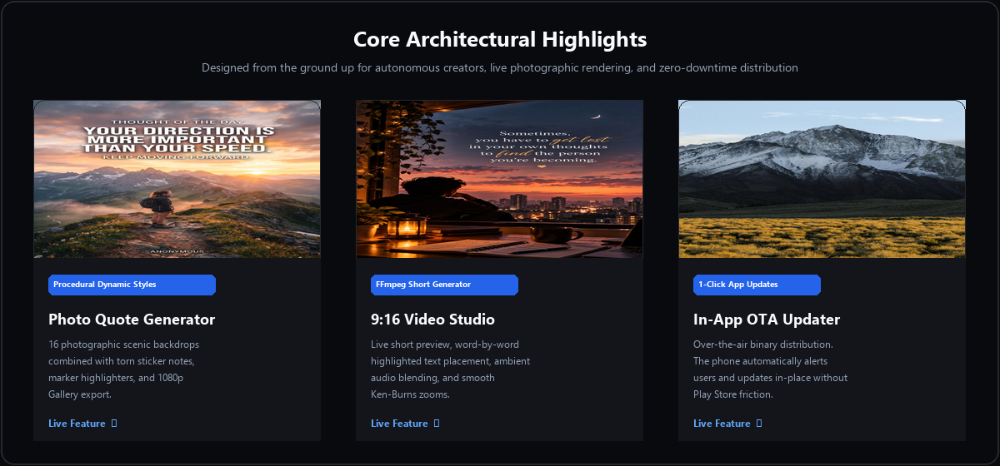
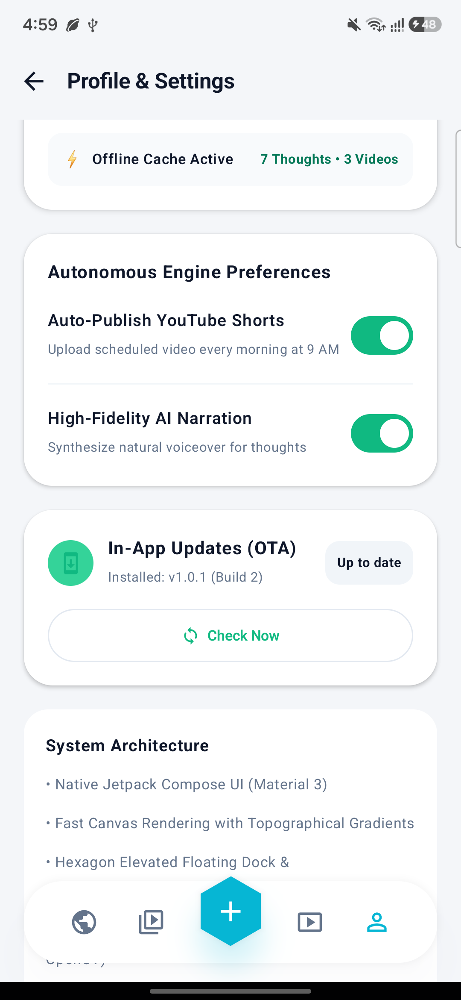
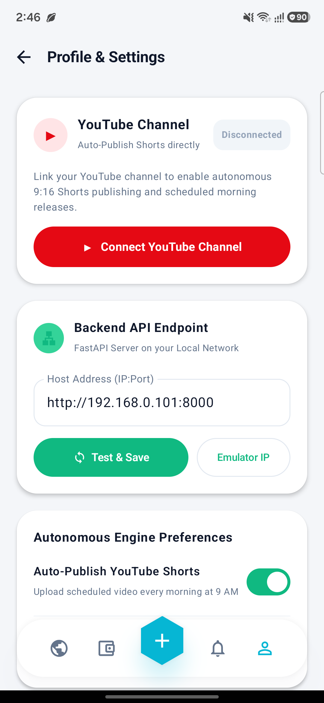
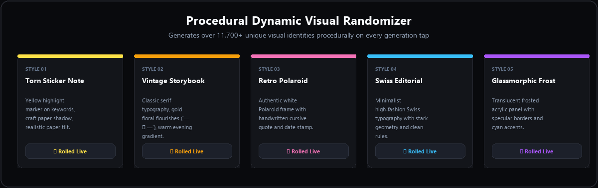

# ThoughtFlow AI

<p align="center">
  
</p>

<p align="center">
  <a href="https://github.com/SyedZiyan/thoughtflow-ai"></a>
  <a href="https://github.com/SyedZiyan/thoughtflow-ai"></a>
  <a href="https://github.com/SyedZiyan/thoughtflow-ai"></a>
  <a href="https://github.com/SyedZiyan/thoughtflow-ai"></a>
  <a href="https://github.com/SyedZiyan/thoughtflow-ai"></a>
  <a href="https://github.com/SyedZiyan/thoughtflow-ai"></a>
</p>

---

## 🌟 Overview

**ThoughtFlow AI** is a production-grade autonomous content engine and mobile creator studio. It crafts original motivational thoughts, procedurally renders high-impact photographic quote canvases and animated 9:16 vertical video shorts, and publishes them automatically to **YouTube Shorts** 24/7 via cloud workers.

The platform includes a **Native Android Mobile App** (Kotlin + Jetpack Compose) styled in an ultra-clean **Obsidian Dark Studio** palette, accompanied by an in-app 9:16 Shorts video player, live procedural canvas, and an **In-App Over-The-Air (OTA) Auto-Updater**.

---

## 📸 Feature Showcase

<p align="center">
  
</p>

### 📱 Real Device Mobile Experience

<p align="center">
  
  &nbsp;&nbsp;&nbsp;&nbsp;
  
</p>

---

## 🎨 Procedural Dynamic Style Randomizer

Instead of static templates, ThoughtFlow features an algorithmic randomizer that creates over **11,700+ unique visual identities**:

<p align="center">
  
</p>

- **16 Scenic Backdrops**: Alpine Trail, Sunrise Summit, Balcony Sunset, Misty Redwood, Starry Cosmos, Golden Dunes, Rainy Evening Window, and Classical Library.
- **5 Layout Architectures**:
  - *Torn Sticker Note*: Keyword highlighter box, organic craft drop shadow, and travel icons.
  - *Vintage Storybook*: Classic serif editorial, gold floral flourishes (`— ❧ —`), and warm vignetting.
  - *Retro Polaroid*: Authentic white frame, cursive script captions, and date stamp.
  - *Swiss Editorial*: Minimalist typography, modern borders, and stark contrast.
  - *Glassmorphic Frost*: Translucent frosted acrylic, specular borders, and quotation typography.
- **7 Contrast Highlighters**: Sunburst Yellow, Matcha Mint, Warm Peach, Ice Cyan, Petal Rose, Amber Gold, and Lavender Frost.
- **1080p Export**: High-resolution gallery export directly to device storage (`Pictures/ThoughtFlow`).

---

## 🏛️ Architecture & System Design

```
thoughtflow-ai/
├── apps/
│   ├── android/         # Native Android App (Kotlin, Compose, Media3 Video Player, In-App OTA)
│   └── web/             # Creator Web Dashboard (React 18, Vite, Tailwind CSS, TanStack Query)
├── backend/
│   ├── app/
│   │   ├── api/v1/      # REST API (Thoughts, Videos, Studio, YouTube OAuth, App Updates)
│   │   ├── core/        # Pydantic v2 settings, Fernet token encryption & JWT auth
│   │   ├── db/          # SQLAlchemy session & SQLite/PostgreSQL engine
│   │   ├── models/      # Database models (User, Thought, Video, Job, Integration)
│   │   ├── schemas/     # Typed Pydantic request/response validation
│   │   ├── services/    # VideoRenderer (Pillow + FFmpeg), YouTube Data API v3, AI Prompts
│   │   └── prompts/     # Wisdom catalogs & thematic generators
│   ├── Dockerfile       # Containerized backend with FFmpeg and system fonts
│   └── requirements.txt
├── worker/
│   ├── scheduler.py     # Standalone 24/7 APScheduler automation worker
│   └── Dockerfile
├── storage/
│   └── videos/          # Compiled 9:16 vertical MP4 video shorts
├── docs/assets/         # Polished showcase assets & screenshots
├── docker-compose.yml   # Multi-container orchestration (PostgreSQL + Backend + Worker + Web)
├── render.yaml          # Zero-downtime 1-click cloud deployment blueprint (Render.com)
└── publish_update.ps1   # 1-Click In-App OTA APK release publisher
```

---

## 🚀 Quickstart & Setup

### 1. Backend Setup
```bash
cd backend
python -m venv .venv
source .venv/bin/activate  # On Windows: .\.venv\Scripts\Activate.ps1
pip install -r requirements.txt
python -m uvicorn app.main:app --reload --port 8000
```
- Interactive Swagger API: `http://localhost:8000/docs`
- Health check: `http://localhost:8000/health`
- Mobile APK Download Landing Page: `http://localhost:8000/download`

### 2. Android Mobile Application
Open `apps/android` in **Android Studio** or build from terminal:
```powershell
cd apps/android
.\gradlew.bat assembleDebug
```
The output APK is generated at:
`apps/android/app/build/outputs/apk/debug/app-debug.apk`

---

## ☁️ 24/7 Cloud Deployment on Render

The backend is fully configured for zero-cost 24/7 hosting on [Render.com](https://render.com) using [`render.yaml`](./render.yaml):

1. Push this repository to GitHub.
2. In Render, select **"New +"** > **"Web Service"** > Connect your repository.
3. Select **Docker** environment. Render builds the container with FFmpeg and launches your 24/7 API.
4. Add your private API keys in Render's **Environment** tab:
   - `GEMINI_API_KEY`: *Your Google Gemini API key*
   - `GOOGLE_CLIENT_ID`: *Your YouTube OAuth Client ID*
   - `GOOGLE_CLIENT_SECRET`: *Your YouTube OAuth Secret*
   - `YOUTUBE_UPLOAD_ENABLED`: `True`

---

## 📲 In-App Over-The-Air (OTA) Updates

ThoughtFlow AI features an integrated binary distribution pipeline:
- Whenever you make code changes, run:
  ```powershell
  .\publish_update.ps1 -VersionName "1.4.0" -ReleaseNotes "Your new features"
  ```
- The backend automatically publishes the new APK metadata.
- All active Android devices immediately display an **"Update Available"** card and update in-place with a single tap.

---

## 🎬 YouTube Shorts Automation

- **Direct Channel Linking**: Connect any creator channel by handle (`@ChannelName`) or Google OAuth 2.0.
- **Scheduled Publishing**: Autonomous daily generation at 07:00 AM and automated upload at 09:00 AM.
- **Smart Metadata**: Automatically generates SEO-optimized video titles, descriptions, and hashtags (`#shorts`, `#motivation`).

---

## 🛡️ Privacy & Security

- **Zero Hardcoded Secrets**: All tokens, client secrets, and API keys are stored in encrypted environment variables and excluded via `.gitignore`.
- **Fernet Token Encryption**: All OAuth refresh tokens are encrypted at rest before storing in the database.

---

<p align="center">
  <b>ThoughtFlow AI</b> • Built with ❤️ for creators, dreamers, and builders.
</p>
