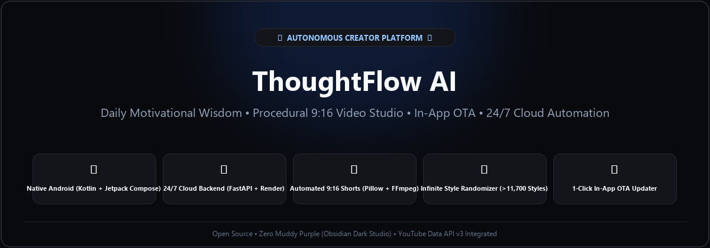
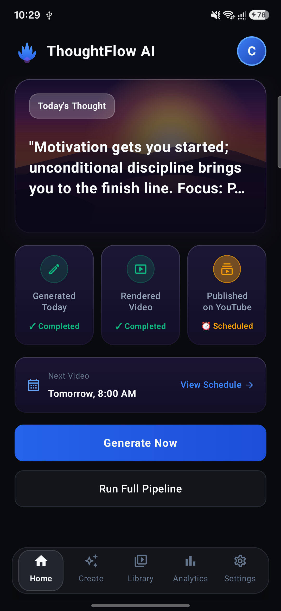
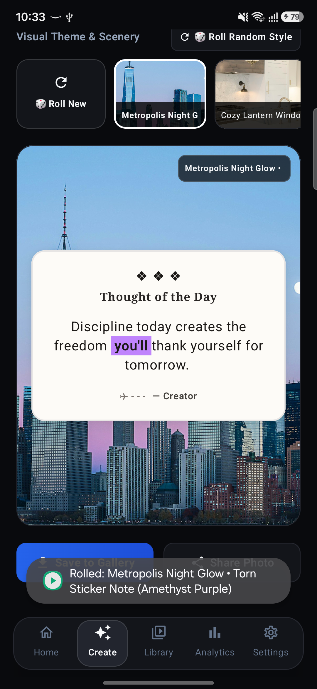
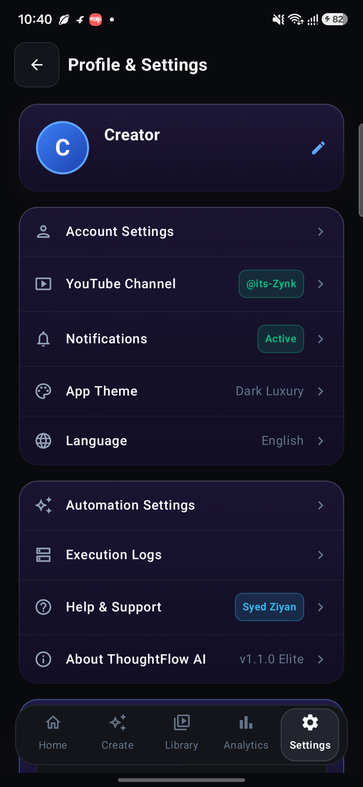

# ThoughtFlow AI

<p align="center">
  
</p>

<p align="center">
  <a href="https://github.com/SyedZiyan/thoughtflow-ai"></a>
  <a href="https://github.com/SyedZiyan/thoughtflow-ai"></a>
  <a href="https://github.com/SyedZiyan/thoughtflow-ai"></a>
  <a href="https://github.com/SyedZiyan/thoughtflow-ai"></a>
</p>

---

## 🌟 What is ThoughtFlow AI?

**ThoughtFlow AI** is an autonomous content creation platform that generates daily motivational wisdom, turns thoughts into high-resolution quote cards and animated 9:16 vertical videos, and automatically publishes them to **YouTube Shorts** 24/7.

It comes with a **Native Android Mobile App** built with Jetpack Compose in a modern **Obsidian Dark Studio** theme.

---

## 📱 Mobile App Preview

Captured live from physical Android hardware:

<p align="center">
  
  &nbsp;&nbsp;
  
  &nbsp;&nbsp;
  
</p>

| 1. Dashboard | 2. Quote Generator | 3. Settings & Channel |
| :--- | :--- | :--- |
| Daily motivational thought, real-time generation stats, and quick actions. | Live procedural quote canvas with scenic backdrops and 1080p Gallery export. | Creator profile, linked YouTube channel (`@its-Zynk`), and automation controls. |

---

## ✨ Key Features

- **🎲 Infinite Dynamic Style Randomizer**: Procedurally generates over 11,700+ unique visual themes across 16 real scenic backdrops, 5 layout styles (*Torn Sticker, Vintage Storybook, Retro Polaroid, Swiss Editorial, Frosted Glass*), and 7 accent highlighters.
- **🎬 Automated 9:16 Video Shorts**: Converts thoughts into animated vertical videos with moving subtitles, dynamic backgrounds, and background music using FFmpeg.
- **🚀 24/7 YouTube Automation**: Automatically renders and publishes daily Shorts to your linked YouTube channel on a schedule (e.g., 9:00 AM daily).
- **📲 In-App Over-The-Air (OTA) Updates**: Update the mobile app directly on your phone with one tap without needing Google Play Store or USB cables.
- **🔒 Privacy & Security**: Zero hardcoded secrets. All API keys and YouTube OAuth tokens are encrypted and managed securely via environment variables.

---

## 🛠️ Tech Stack

| Layer | Technology | Purpose |
| :--- | :--- | :--- |
| **Mobile App** | Kotlin, Jetpack Compose, Material 3 | High-performance native Android UI |
| **Backend API** | Python 3.11, FastAPI, SQLAlchemy | REST API, thought generation & task scheduling |
| **Video Engine** | FFmpeg, Pillow (PIL) | 9:16 vertical video composition & animation |
| **Cloud Hosting** | Render.com, Docker | 24/7 automated background execution |
| **Integrations** | YouTube Data API v3, Google Gemini AI | Video publishing & AI thought generation |

---

## 🚀 How to Run

### 1. Run the Backend Locally
```bash
cd backend
python -m venv .venv
source .venv/bin/activate  # On Windows: .\.venv\Scripts\Activate.ps1
pip install -r requirements.txt
uvicorn app.main:app --reload --port 8000
```
- API Documentation: `http://localhost:8000/docs`
- APK Download Page: `http://localhost:8000/download`

### 2. Build the Android App
Open the `apps/android` folder in **Android Studio** and click **Run**, or build via terminal:
```powershell
cd apps/android
.\gradlew.bat assembleDebug
```
The APK will be generated at:
`apps/android/app/build/outputs/apk/debug/app-debug.apk`

### 3. Deploy to Cloud

#### Option A: Quick Cloud Demo (Render Free Tier)
The repository includes a production-ready [`render.yaml`](./render.yaml) for hosting the API with a free HTTPS URL:
1. Create a free account on [Render.com](https://render.com).
2. Click **New +** > **Blueprint** > Connect your **`thoughtflow-ai`** GitHub repository.
3. Render automatically builds the Docker container and assigns an HTTPS URL (`https://your-service.onrender.com`).
4. Add your `GEMINI_API_KEY` and YouTube credentials in Render's **Environment** tab.
> [!NOTE]
> Render's free web tier is an on-demand service that spins down after 15 minutes of inactivity and has an ephemeral filesystem. It is ideal for API demos and testing.

#### Option B: Durable 24/7 Production Automation (Oracle Cloud Always Free or VPS)
For continuous background scheduling and durable video storage:
1. Deploy via **Docker Compose** on a persistent server (e.g., [Oracle Cloud Always Free](https://cloud.oracle.com/) 4-core / 24 GB RAM VM or a Linux VPS):
   ```bash
   git clone https://github.com/SyedZiyan/thoughtflow-ai.git
   cd thoughtflow-ai
   cp .env.example .env
   docker-compose up -d --build
   ```
2. Your backend, database, and background workers run 24/7 with persistent storage volumes and no sleep timeouts.

---

## 📄 License

This project is open-source and licensed under the [MIT License](LICENSE). Copyright (c) 2026 Syed Ziyan.
